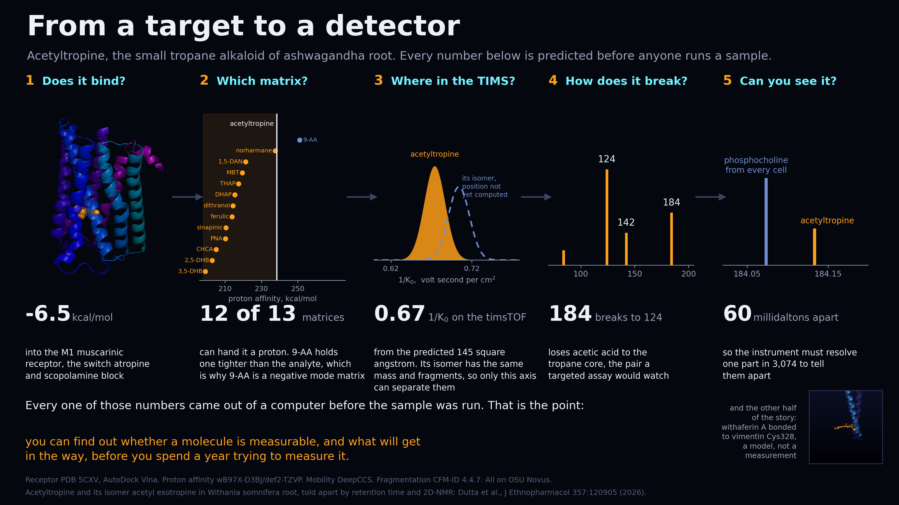

# Acetyltropine, from a target to a detector



**Before you spend lots of time and resources trying to measure a potentially bioactive molecule, can we be better at working out how it might be measurable at all?**

This repo is meant to step you through running a small little compound on your own hardware, then step it up to more and more compute power. The nice part for the chemist is that if you can understand how one molecule would do it, doing it with thousands makes more sense.

The first compound is acetyltropine, a tropane alkaloid of ashwagandha root (*Withania somnifera*). It is a good example because it is small, it is real, and every stage gives an answer in minutes rather than days. Also, we figured out some interesting bioactivity about it recently (https://www.sciencedirect.com/science/article/pii/S0378874125015971). It highlights for me about how interesting it is that life chooses to build molecules in a particular direction. For more pondering check out 2026's chemistry Nobel prize winners: https://www.nobelprize.org/uploads/2026/10/press-chemistryprize2026.pdf

The code here covers four of the five stages on the header image of this README:

1. **Does it bind?** Dock it into the M1 muscarinic receptor, the switch that atropine and scopolamine block.
2. **Does it take a charge?** Compute its proton affinity, which is what decides whether a MALDI matrix can ionize it.
3. **How does it break?** Predict its fragmentation, which is what a targeted assay actually watches.
4. **Can you see it?** Work out what else arrives at the same mass in a tissue section.

Stage 3 on the slide, the ion mobility, is not here. It needs a trained CCS predictor, and the one we used would not separate acetyltropine from its isomer anyway, which is a limitation worth knowing rather than a step to copy.

And one more thing in between, which is the part worth your attention:

**Does the method work at all?** Redock a ligand whose real position is already known, and see whether the software finds it.

## Run it

On a cluster, spread across multiple GPUs, the whole thing: docking, the redock check, the protonation comparison, the proton affinity by DFT, fragmentation, and the interference check:

```
bash setup_env.sh          # two conda environments, once
sbatch run.sbatch          # edit the account line first
```

On one machine with no scheduler, everything except the proton affinity. We run Docking as CPU only, so this does not need a GPU if you don't have one:

```
bash setup_env.sh          # the `dock` environment is the only one you need
conda activate dock
bash run_local.sh          # about ten minutes on 16 cores
```

Each step also runs on its own:

```
python prep.py             # fetch 5CXV, build the receptor and seven ligands
python dock.py             # dock them, report two kinds of score
python redock.py           # check the setup against a pose we already know
python protonation.py      # what getting the protonation wrong costs
python fragment.py         # CFM-ID, fetches a container the first time
python interference.py     # what else lands at 184.133
python sp.py acetyltropine_mh.xyz 1 1 cation    # needs a GPU
```

## The three things this example is really about

**A docking score is not evidence that the pose is right.** `redock.py` takes tiotropium, whose position in 5CXV was measured by crystallography, and docks it back in. It lands 0.97 angstrom from where it actually sits, which passes. If it had not, nothing else the docking says could be trusted, and the scores would have looked perfectly reasonable anyway.

**Getting the protonation wrong is invisible in the score.** Every tropane here except tiotropium is a tertiary amine with a pKa near 9.5, so at body pH it carries a proton, and that ammonium makes the salt bridge that anchors it. `prep.py` builds them that way. `protonation.py` builds them both ways, changes nothing else, and docks both:

| ligand | protonated | neutral | score moves | pose moves |
|---|---|---|---|---|
| 3-tigloyloxytropane | -7.72 | -7.79 | +0.07 | **2.37 A** |
| atropine | -9.14 | -9.29 | +0.16 | 1.49 A |
| scopolamine | -9.45 | -9.33 | -0.12 | 1.37 A |
| cocaine | -9.40 | -8.93 | -0.47 | **3.22 A** |
| tropine | -5.72 | -5.98 | +0.26 | 0.69 A |
| acetyltropine | -6.51 | -6.50 | -0.01 | 0.08 A |
| tiotropium | -9.29 | -9.29 | +0.00 | no basic N |

The score never moves half a kcal/mol. The pose moves anywhere from nothing to three angstrom, and the two columns have nothing to do with each other. Acetyltropine barely moves because it is small and rigid; the flexible esters swing right round. So the answer is not "protonation always matters", it is that the error is invisible in the score and you cannot guess which case you are in. You check.

**How you keep score decides who wins.** `dock.py` prints the raw score and the score per heavy atom, and prints both rankings. They come out exactly reversed:

```
rank by raw score:      scopolamine, tiotropium, atropine, 3-tigloyloxytropane, acetyltropine, tropine
rank by score per atom: tropine, acetyltropine, 3-tigloyloxytropane, atropine, scopolamine, tiotropium
```

Bigger molecules make more contacts, so they climb the raw ranking almost automatically. Acetyltropine is 13 heavy atoms, about half the size of the drugs it is up against. Neither column is wrong. Reporting only one of them is.

## Then scale it, and that is where the GPU comes in

Seven ligands do not need a GPU, and `run_local.sh` does them on CPU in minutes. The GPU case is throughput: a screening library, not a handful of compounds.

```
sbatch --gres=gpu:1 scale_gpu.sbatch     # then 2, then 4
```

That docks 1,997 drug-like compounds plus the seven tropanes with Uni-Dock, splitting the list across however many GPUs the job is given. Every ligand is independent and nothing is communicated between GPUs, so wall time should fall close to linearly with GPU count. The job prints `ligands_per_s`; run it at one, two and four GPUs and compare.

It finishes by answering the question the seven-ligand example cannot:

```
ligand                     score  heavy     raw rank   per-atom rank
acetyltropine              -6.51     13     1768/2004       147/2004
```

Seven ligands tell you nothing about whether a score is good. Two thousand give it a distribution to sit in, and acetyltropine's two ranks land at opposite ends of it.

This scaling behaviour is the argument behind the compute request the repository was written for.

## Files

| File | What it does |
|---|---|
| `prep.py` | Downloads PDB 5CXV, prepares chain A with PDBFixer and Open Babel, and builds the ligands from `ligands.smi` with their ring nitrogens protonated. |
| `ligands.smi` | Seven tropanes: acetyltropine, tropine and 3-tigloyloxytropane from the root, plus tiotropium, atropine, scopolamine and cocaine as known tropane ligands to measure against. |
| `dock.py` | AutoDock Vina, box centred on the crystal ligand. Writes `scores.json` and the poses. |
| `redock.py` | The correctness check described above. Symmetry-aware RMSD, computed in place without realignment, because realigning would quietly forgive a pose in the wrong place. |
| `protonation.py` | Docks every ligand protonated and neutral and tabulates what changed. |
| `sp.py`, `acetyltropine{,_mh}.xyz` | GPU4PySCF single points on the neutral molecule (30 atoms) and the ring-nitrogen protomer (31 atoms). The difference is the proton affinity. |
| `fragment.py` | CFM-ID fragmentation prediction. Fetches the container itself, and says what to install if neither Apptainer nor Docker is present. |
| `interference.py` | The matrix cluster series and the ubiquitous tissue ions, against the analyte mass, each with the resolving power needed to separate it. |
| `run.sbatch` | All of it, in one Slurm job. |
| `run_local.sh` | Everything except the proton affinity, on one machine, no scheduler. |
| `scale_gpu.sbatch`, `prep_library.py`, `rank.py` | The same docking on 1,997 compounds with Uni-Dock, split across GPUs, then where acetyltropine ranks among them. |
| `ligands_2000.smi` | 2,000 drug-like compounds (MW 180 to 500) from public MS/MS libraries. |

## What it needs

A machine with GPUs and Slurm. AutoDock Vina, RDKit, Meeko, PDBFixer, Open Babel and Open Babel's `obabel` on PATH for the docking side; PySCF and GPU4PySCF for the proton affinity. `setup_env.sh` builds both.

Developed on Oregon State's Novus cluster for the 2026 OSU Huang Complex Supercomputing Seed Fund application, "From target to detector, predicting the ions that therapeutic small molecules actually form in mass spectrometry". Luke Marney, Oregon State University.

The acetyltropine chemistry it rests on is in Dutta et al., *J Ethnopharmacol* **357**:120905 (2026), which synthesized the compound, separated it from its isomer acetyl exotropine by retention time and 2D-NMR, and showed the root extract's effect in *Drosophila*.
